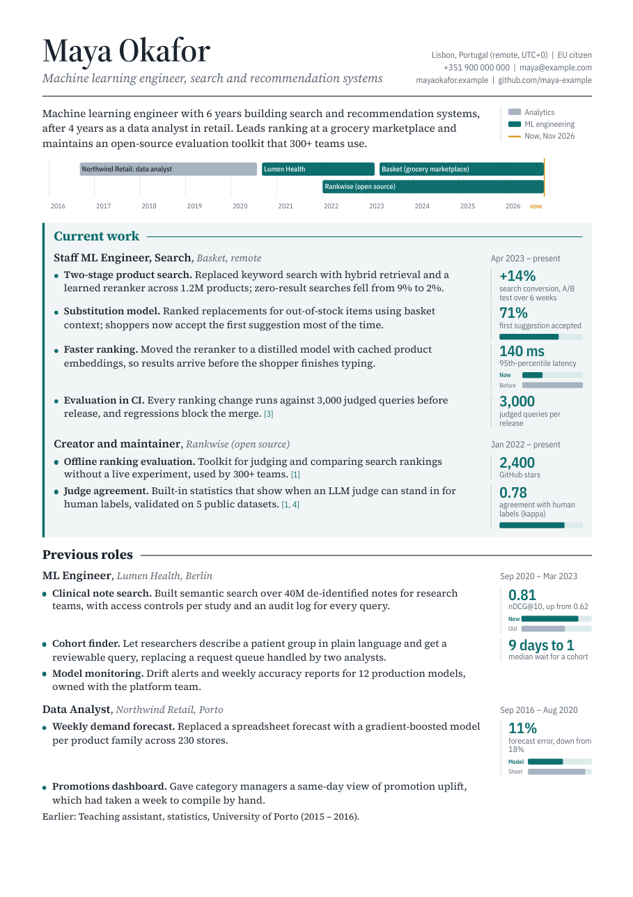
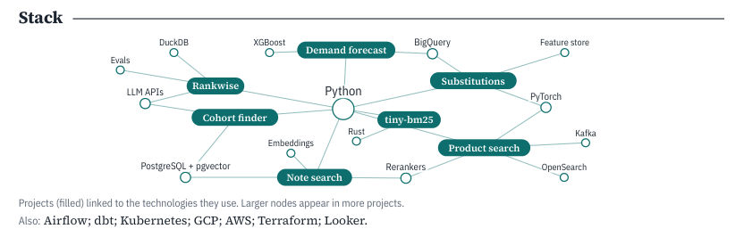

# Showcase Your Skills: resume designer

A Claude skill that turns your work history into a designed two-page resume where **every claim sits beside its proof**.

The left column says what you did. A narrow margin on the right shows the measured result: a number, a short label, sometimes a small chart. Someone skimming only the margin still sees your impact.



Every resume also gets a **skills graph** in place of a skills list. It links each project to the technologies it runs on, and the technologies you use on the most projects are drawn largest, so a reader sees what you know and where you used it.



The person in the example is fictional. [See the full PDF](examples/example.pdf), or [page 2 as an image](docs/example-page-2.png).

## What you get

- **A designed PDF** to send to people: margin figures, a career timeline, a tinted panel for current work, and the skills graph that links your projects to the technologies they use.
- **A plain PDF and Word file** for application forms: one column, no charts, standard headings, same words and numbers. ([example](examples/example-plain.pdf))
- **Tailored versions** for individual jobs, checked against your master resume so that no number, date or job title can change between versions.
- **A list of sources**: every figure on the page next to where it came from.

## What you give it

Whatever you have: an old resume, LinkedIn text, a portfolio, or a description of your work in chat. If Claude can read your project folders, it can look up real numbers there.

Claude drafts the resume, asks you to confirm anything it could not verify, and asks for numbers where a claim has none. It is told never to estimate, round up or invent a figure. A claim without a real number gets an empty margin.

The result is as strong as your evidence. If you have measurable results, the margin fills up. If you do not, you get a clean layout with gaps that show you where proof is missing.

## Who it suits best

Any resume can use the layout, but each part of the page rewards a particular kind of career. It suits you best if your work produces numbers, spans several projects or tools, or changed direction along the way.

| Profession | Why the page works for it |
| :--- | :--- |
| Software, data and machine learning engineers | Latency, accuracy, uptime and cost fill the margin. Comparison bars show before and after, or your system against a baseline. The graph shows which technologies you used on which project, which a skills list cannot. |
| Data analysts and data scientists | Forecast error, model lift and time saved are margin figures by nature, and the comparison bars are made for "old method against new". |
| Product managers | Adoption, retention and conversion sit beside the feature that moved them, so the reader sees outcomes before features. |
| Growth, performance and lifecycle marketers | Conversion rates, cost per acquisition, revenue and open rates. Range bars suit results that vary by campaign. |
| Sales and account management | Quota attainment as a fill bar, deal size, pipeline and renewal rates. The margin reads like a scorecard. |
| Operations, supply chain and logistics | Hours saved, error rates, throughput and cost, usually with a clear before and after. |
| Customer success and support leaders | Retention, response times and satisfaction scores, each tied to the change that produced it. |
| Researchers moving into industry | The numbered publications list lets a bullet cite the paper behind it, and benchmark results fit the comparison bars. |
| Consultants, freelancers and agency owners | Many clients and projects at once: the timeline shows overlapping engagements, and the graph ties each project to its tools. |
| Founders and early-stage operators | Revenue, team size and customers as margin figures, with the timeline showing ventures that ran in parallel. |
| Career changers | The timeline colors each role by kind of work, so a move from one field to another reads as a clear story, not a gap. |

It suits you less if:

- **your results are hard to put a number on**, as in much of teaching, care work, law and the creative fields. You still get a clean layout, but most margins stay empty, and a conventional resume may serve you as well;
- **your field expects a fixed format**, such as an academic CV of many pages, a government application or a legal resume. Use the format your field expects;
- **your work is judged by a portfolio**, as in visual design, illustration or photography. Lead with the portfolio.

## Install

You need Python 3.8 or later, and Chrome, Edge or Chromium for the PDF step. Nothing else: the scripts use only Python's standard library, and the fonts are included.

**Claude Code**

```
git clone https://github.com/anthonylee991/showcase-your-skills-resume-designer ~/.claude/skills/showcase-your-skills-resume-designer
```

Then ask Claude: "Make me a resume with the showcase-your-skills-resume-designer skill", and attach or paste your material.

**Other Claude apps**

Download this repo as a ZIP and add it as a custom skill in Claude's settings. The skill was built and tested in Claude Code. Making the PDF needs a Chromium-based browser on the machine that runs the script; without one you still get the HTML and the Word file, and can print the HTML to PDF yourself.

## Run it without Claude

The renderer is an ordinary script. Copy [examples/example.json](examples/example.json), edit it ([field reference](references/schema.md)), then:

```
python scripts/render.py my-resume.json --plain --sources
```

Before rendering it checks the file and names every missing or malformed field. After rendering it reports:

- a missing skills graph;
- margin figures that have no source;
- the page count;
- layout problems: bullets over three lines, nearly empty last lines, figures that wrap, timeline labels that run off the edge, graph labels that overlap.

## Will an applicant-tracking system read it?

Measured, not promised. Six text extractors were run on the example and 60 pieces of content were checked for reading order.

| File | Extractors that follow the PDF's stored text order | Extractors that rebuild order from positions on the page |
| :--- | :--- | :--- |
| Designed PDF | 59 or 60 of 60 | 41 to 48 of 60 |
| Plain PDF | 61 of 61 | 61 of 61 |

In the designed PDF, software that rebuilds the reading order from page positions reads the main column first and the margin afterwards, so dates and figures arrive separated from their roles. That is why the plain version exists: send the designed PDF to people, and upload the plain one to forms.

No commercial applicant-tracking system and no dedicated resume parser has been tested.

## What it does not do

- Cover letters or interview preparation.
- Languages written right to left, or non-Latin scripts beyond Greek, Cyrillic and Vietnamese (those three load their fonts from Google Fonts and need a connection).
- More than two pages for the designed version. The skill cuts words, not type size.

## How the skill is laid out

| Path | What it is |
| :--- | :--- |
| [SKILL.md](SKILL.md) | The instructions Claude follows |
| [references/schema.md](references/schema.md) | Every field of the resume JSON |
| [scripts/render.py](scripts/render.py) | Checks the JSON, writes the HTML and PDF, measures the layout |
| [scripts/plain.py](scripts/plain.py) | The plain PDF and Word version |
| [scripts/variant.py](scripts/variant.py) | Checks a tailored version against its master |
| [assets/](assets/) | Stylesheet and fonts |
| [examples/](examples/) | A fictional resume as JSON, with its rendered files |

## License

MIT for the skill and its code: see [LICENSE](LICENSE). The bundled fonts, Source Serif 4 and IBM Plex Sans Condensed, are under the SIL Open Font License: see [assets/fonts/LICENSE.txt](assets/fonts/LICENSE.txt).

Made by [Anthony Lee](https://github.com/anthonylee991).
